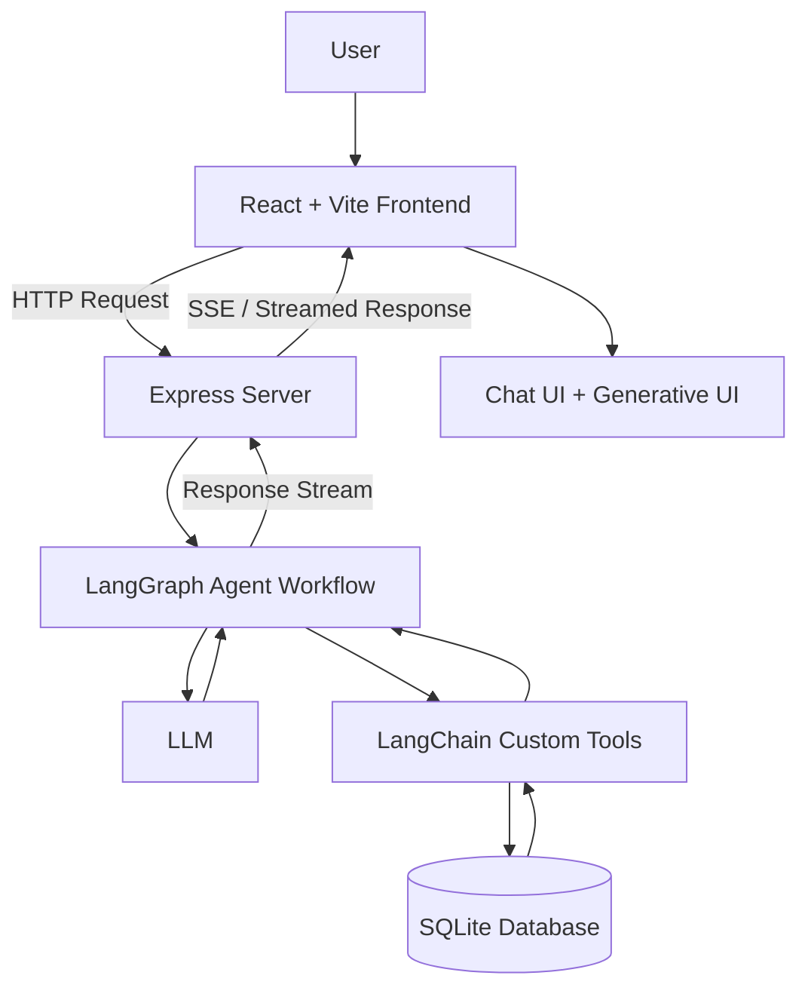

# AI Expense Tracker with Generative UI

An AI-powered expense tracker that lets you manage and explore your expenses through natural conversation.

Instead of relying only on traditional forms and dashboards, you can interact with an AI assistant that understands your requests, works with your expense data, and presents information through an interactive Generative UI experience.

This project explores how custom AI agents can go beyond answering questions and interact with real application data.

## ✨ Features

- **AI-Powered Expense Management** — interact with your expenses using natural language.
- **Custom AI Agent** — an agent built with LangGraph that follows a defined workflow to handle user requests.
- **Custom Tools** — tools built with LangChain allow the agent to interact with the expense database.
- **Generative UI** — display UI components alongside conversational responses.
- **Streaming Responses** — receive AI responses progressively instead of waiting for the entire response to finish.
- **SQLite Database** — store and manage expense data locally.
- **Interactive Chat Interface** — communicate with the AI through a React-based frontend.

## 💬 Example Interactions

You can interact with the expense tracker using everyday language.

| Example request | What the agent does |
|---|---|
| "Add an expense of ₹500 for groceries" | Uses the appropriate tool to add an expense. |
| "Show me my expenses this month" | Retrieves relevant expense data. |
| "Update my last expense" | Uses the available tools to update an expense when the target is clear. |
| "How much have I spent?" | Retrieves the relevant data and generates a response. |

*These examples illustrate the intended interaction style; exact behavior depends on the tools and workflows implemented in the project.*

## 🏗️ System Architecture

The application has three main parts:

- **Frontend:** React and Vite provide the chat interface and render the UI.
- **Backend:** Express receives requests, runs the agent workflow, and streams responses to the frontend.
- **Database:** SQLite stores expense records that the agent's tools can access.

### Architecture Diagram



The agent coordinates the workflow, the tools handle database operations, and the frontend displays the resulting information.

## 🤖 How the AI Agent Works

The agent is built using **LangGraph and LangChain**, with each library serving a different purpose.

### LangGraph — Agent Workflow

LangGraph is used to create a custom graph that defines how the agent processes a request.

The workflow determines whether the agent can respond directly or needs to call a tool to retrieve or modify information. After a tool executes, its result can be passed back into the workflow so the agent can generate a response.

### LangChain — Custom Tools

LangChain is used to build custom tools that connect the agent to the application's functionality.

These tools allow the agent to perform supported operations on the expense database rather than simply generating answers from the language model alone.

### Putting It Together

For example, when a user asks about their spending, the agent can call a tool to retrieve the relevant records, use the returned information, and generate a natural-language response.

This makes the assistant capable of interacting with application data through a controlled workflow.

## ⚡ How Response Streaming Works

The application uses Server-Sent Events (SSE) or an SSE-formatted response stream to deliver generated content from the backend to the frontend.

1. The user submits a question through the React interface.
2. The frontend sends the question to the Express server.
3. Express passes the request to the LangGraph agent workflow.
4. The agent processes the request and calls custom tools when necessary.
5. The backend receives the generated content and streams it to the frontend.
6. The frontend consumes the incoming stream and updates the chat interface as content arrives.

Streaming makes the conversation feel more responsive because users can see the answer as it is generated.

## 🎨 Generative UI

Traditional chat interfaces primarily display text. Generative UI extends this experience by allowing the application to display relevant interface components alongside conversational responses.

In this project, the frontend supports rendering UI components as part of the interaction, making the experience more visual and interactive.

The goal is to combine the flexibility of natural-language interaction with the clarity of a graphical interface.

## 🛠️ Tech Stack

| Area | Technology |
|---|---|
| Frontend | React, Vite, TypeScript |
| Backend | Node.js, Express.js |
| Agent Workflow | LangGraph |
| AI Tools | LangChain |
| Language Model | LLM integration |
| Database | SQLite using `node:sqlite` |
| Response Streaming | SSE / streamed HTTP responses |

## 🚀 Getting Started

The project runs locally and requires the frontend and backend dependencies to be installed.

### Prerequisites

- Node.js version compatible with the project's dependencies
- npm
- An API key for the language model provider used by the project

### Installation

Clone the repository:

```bash
git clone https://github.com/harry-sketch/Ai-Expense-Tracker-With-Generative-UI.git

cd Ai-Expense-Tracker-With-Generative-UI
```

Install the dependencies for the frontend and backend using their respective `package.json` files.

Configure the required environment variables according to the project's setup, including the LLM provider's API key.

Start the backend and frontend using the scripts defined in their respective `package.json` files.

> **Note:** Exact directory names, environment variable names, and start commands should be confirmed against the current repository before publishing these instructions.

## 🧠 Key Concepts Explored

This project explores several practical concepts in AI application development:

- Building custom AI agent workflows with LangGraph.
- Creating tools that allow an AI agent to interact with application data.
- Connecting an LLM to a real database through controlled operations.
- Streaming AI-generated responses to a frontend.
- Combining conversational interfaces with Generative UI.
- Separating frontend, backend, agent workflow, and data responsibilities.


## 📌 About the Project

This is a learning project focused on building an AI-powered application where an agent can interact with real data and support a more dynamic user experience.

The main idea is simple: **move beyond a chatbot that only answers questions and build an application where AI can take action and the interface can respond interactively.**
